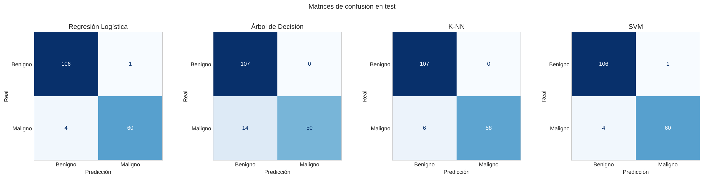
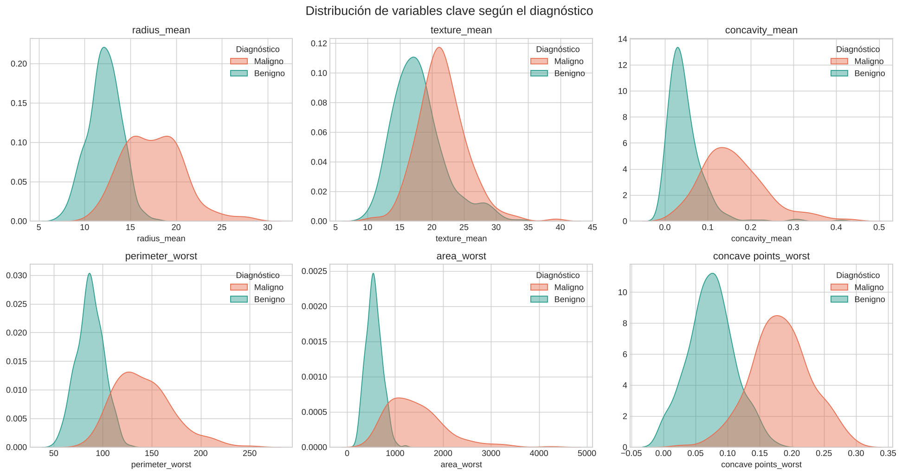
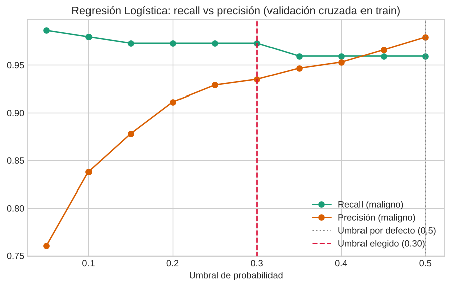

# 🩺 Clasificación de tumores de mama con aprendizaje supervisado

Comparación de cuatro modelos de *machine learning* (**Regresión Logística, Árbol de Decisión, K-NN y SVM**) para predecir si un tumor de mama es **benigno o maligno** a partir de 30 características morfológicas de los núcleos celulares. El proyecto da especial importancia a los **falsos negativos**, que son el error más grave en un contexto clínico.


> Proyecto de la asignatura **Aprendizaje Automático I** (Grado en Ciencia de Datos e Inteligencia Artificial, UPM · curso 2025-26), realizado por **Antía Sande Fernández** y **Candela Espinar Paisan**.

**👉 [Notebook completo](notebooks/clasificacion_tumores_mama.ipynb) · [Memoria (PDF)](docs/memoria.pdf) · [Presentación (PDF)](docs/presentacion.pdf)**

---

## Resultados

| Modelo | Accuracy | Recall (maligno) | AUC | Falsos negativos | Falsos positivos |
|---|---|---|---|---|---|
| **Regresión Logística** | **0,971** | **0,938** | 0,998 | **4** | 1 |
| **SVM** (RBF) | **0,971** | **0,938** | 0,995 | **4** | 1 |
| K-NN | 0,965 | 0,906 | **0,999** | 6 | 0 |
| Árbol de Decisión | 0,918 | 0,781 | 0,919 | 14 | 0 |
| **Regresión Logística, umbral ajustado** ⭐ | **0,982** | **0,969** | 0,998 | **2** | 1 |

<sub>Conjunto de test: 171 tumores (107 benignos, 64 malignos), que no se usaron en ningún momento del entrenamiento.</sub>



**Conclusión:** la **Regresión Logística** es el modelo recomendado. Empata con la SVM en *accuracy*, pero es más sencilla, más interpretable y es la **mejor calibrada** (Brier score 0,019), así que sus probabilidades se pueden interpretar como un riesgo. Si además se **ajusta el umbral de decisión** para priorizar los malignos, los falsos negativos en test **bajan de 4 a 2** sin añadir ningún falso positivo.

## Datos

Se usa el dataset [**Breast Cancer Wisconsin (Diagnostic)**](https://archive.ics.uci.edu/dataset/17/breast+cancer+wisconsin+diagnostic) del UCI Machine Learning Repository (W. Wolberg, W. Street y O. Mangasarian, licencia CC BY 4.0). Contiene 569 tumores: 357 benignos y 212 malignos.

Cada tumor se describe con **10 medidas** de los núcleos celulares (radio, textura, perímetro, área, suavidad, compacidad, concavidad, puntos cóncavos, simetría y dimensión fractal). De cada medida se dan tres valores: la media (`_mean`), el error estándar (`_se`) y el "peor caso" (`_worst`), que es la media de los tres valores más extremos. En total son 30 variables.



Las variables de **tamaño** y de **irregularidad del contorno** separan muy bien las dos clases. En cambio, hay **multicolinealidad fuerte**: radio, perímetro y área tienen correlaciones superiores a 0,99.

## Metodología

1. **Limpieza:** se eliminan la columna vacía `Unnamed: 32` y el identificador `id`, y se codifica el diagnóstico (B → 0, M → 1). No hay valores nulos ni filas duplicadas.
2. **Análisis exploratorio:** distribuciones, correlaciones, *pairplots* y comparación de variables por clase.
3. **División 70 / 30 estratificada** en entrenamiento y test.
4. **Pipelines** `StandardScaler` + modelo, para que el escalado se ajuste solo con los datos de entrenamiento de cada fold y no haya *data leakage*.
5. **`GridSearchCV`** con validación cruzada de 5 folds para elegir los hiperparámetros de cada modelo:

   | Modelo | Mejores hiperparámetros |
   |---|---|
   | Regresión Logística | `C = 1`, `solver = liblinear` |
   | SVM | `kernel = rbf`, `C = 10`, `gamma = scale` |
   | K-NN | `k = 11`, distancia Manhattan, ponderación por distancia |
   | Árbol de Decisión | `max_depth = 3`, `min_samples_leaf = 4`, `criterion = gini` |

6. **Evaluación en test** con *accuracy*, *recall* y precisión de la clase maligna, F1, AUC, matrices de confusión, curvas ROC y **curvas de calibración**.
7. **Interpretación del árbol:** sus reglas se traducen a las unidades originales de cada variable. Por ejemplo: *si `perimeter_worst` > 112,8 y `concave points_worst` > 0,14 → maligno*.
8. **Ajuste del umbral de decisión** (ampliación posterior a la entrega). En lugar de usar el umbral por defecto de 0,5, se elige el que maximiza el *recall* manteniendo una precisión ≥ 0,93. El umbral se elige **solo con predicciones de validación cruzada sobre el entrenamiento**, sin mirar el test.



## Estructura del repositorio

```
├── data/
│   └── Cancer_Data.csv                    # Dataset original
├── notebooks/
│   └── clasificacion_tumores_mama.ipynb   # Análisis completo, con todas las salidas
├── docs/
│   ├── memoria.pdf                        # Memoria entregada
│   ├── presentacion.pdf                   # Presentación de la defensa
│   └── img/                               # Figuras del README
├── requirements.txt
└── README.md
```

## Cómo ejecutarlo

```bash
git clone https://github.com/antiasande/breast-cancer-classification.git
cd breast-cancer-classification
pip install -r requirements.txt
jupyter notebook notebooks/clasificacion_tumores_mama.ipynb
```

El notebook usa una semilla fija (`RANDOM_STATE = 42`), así que los resultados son reproducibles.

## Cambios respecto a la entrega original

Al preparar el repositorio, revisamos el notebook y lo mejoramos:

- Ahora carga los datos desde una ruta del repositorio, en vez de pedir que se suba el fichero en Google Colab, así que funciona en cualquier entorno.
- Se han eliminado celdas duplicadas y se ha unificado la limpieza de datos en un solo paso.
- Se ha fijado la semilla del Árbol de Decisión. Sin ella, el árbol elegido cambiaba en cada ejecución (en la entrega salió uno sin límite de profundidad, con 0,936 de *accuracy*), y algunos comentarios no coincidían con las salidas.
- Las reglas del árbol se muestran en las unidades originales. Antes aparecían en unidades estandarizadas, por ejemplo `perimeter_worst <= 0.16`.
- En la calibración ya no se incluye la SVM, porque sus puntuaciones no son probabilidades.
- Se ha añadido la sección de **ajuste del umbral** para reducir los falsos negativos.

## Limitaciones y trabajo futuro

- El conjunto de test es pequeño (64 malignos), así que cada error cambia bastante las métricas. Una validación cruzada repetida daría intervalos de confianza más fiables.
- La práctica no permitía usar PCA ni modelos *ensemble*. Sería interesante probar Random Forest o Gradient Boosting, y reducir la multicolinealidad seleccionando variables.

## Autoras

- **Antía Sande Fernández** · [GitHub](https://github.com/antiasande)
- **Candela Espinar Paisan**

## Tecnologías

Python · pandas · NumPy · scikit-learn · Matplotlib · seaborn · Jupyter
